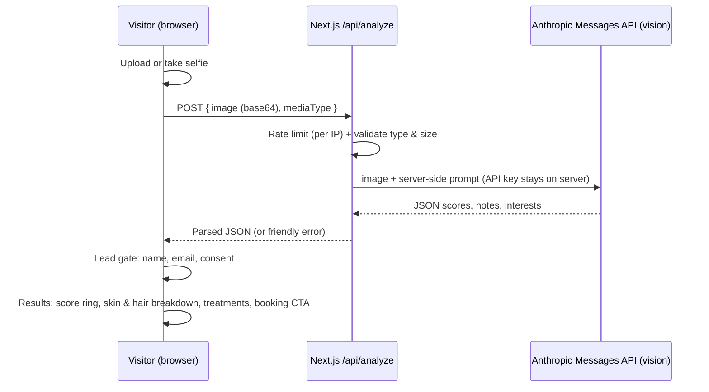

# GlowScan: AI Skin & Hair Assessment (lead-generation app)

A Next.js app where a visitor takes a selfie, an LLM with vision returns a cosmetic skin and hair profile, and the full results unlock after the visitor leaves their contact details. Designed as a white-label lead magnet for aesthetics clinics.

> **Portfolio note.** I originally built GlowScan in May 2026 for a med-spa marketing agency's clinic clients. This version is white-labelled with a fictional clinic ("Lumen Aesthetics"). Client branding, advisor names, booking links and any lead data are removed. Changes from the original prototype are listed in [`docs/03-decisions.md`](docs/03-decisions.md).

---

## Why it exists

Clinic websites usually ask prospects to "fill in a form". GlowScan swaps the form for a value exchange: the prospect gets a personalised, fun assessment, and the clinic gets a lead that already knows which treatments interest them.

## How it works



Flow: **Welcome → Capture → Analyzing → Lead gate → Results**

## Features

- Camera capture with a face-guide overlay, or drag-and-drop upload
- Skin metrics (8) and hair metrics (6) with animated bars and an overall score ring
- Treatment suggestions mapped from the model's "interest areas"
- Results gated behind name, email and an explicit consent checkbox
- Server-side API proxy: the key, model and prompt are never exposed to the browser
- Per-IP rate limiting (default 5 scans per hour), input type and size validation
- White-label config through environment variables

## Run it locally

```bash
npm install
cp .env.example .env.local     # add ANTHROPIC_API_KEY
npm run dev                    # http://localhost:3000
```

## Deploy (Vercel)

1. Push this repo to GitHub.
2. In Vercel: **Add New → Project → Import** this repo.
3. Add the environment variables from `.env.example` (at minimum `ANTHROPIC_API_KEY`).
4. Deploy.

## Project structure

```
app/
  layout.tsx            Root layout
  page.tsx              Renders <GlowScan />
  api/analyze/route.ts  Server proxy: rate limit → validate → Anthropic → parse JSON
components/
  GlowScan.jsx          The whole client UI (state machine over 5 steps)
lib/
  prompt.ts             Analysis prompt (server-only)
  rateLimit.ts          In-memory fixed-window limiter
  brand.js              White-label config
docs/                   Requirements, architecture decisions, compliance notes, status
```

## Docs

- [`docs/01-requirements.md`](docs/01-requirements.md)
- [`docs/02-architecture.md`](docs/02-architecture.md)
- [`docs/03-decisions.md`](docs/03-decisions.md)
- [`docs/04-compliance-and-safety.md`](docs/04-compliance-and-safety.md)
- [`docs/05-status-and-roadmap.md`](docs/05-status-and-roadmap.md)

## My role

Product concept, UX flow and visual design direction (I supplied the final design as HTML), prompt and output-schema design, deployment setup. The code was written with AI assistance (Claude) from my specifications and revised over several iterations.

## Tech

Next.js 14 (App Router) · React 18 · TypeScript · Anthropic Messages API (vision) · Vercel

## Disclaimer

Cosmetic and entertainment use only. Not a medical device, and not a diagnosis.

## Licence

MIT
