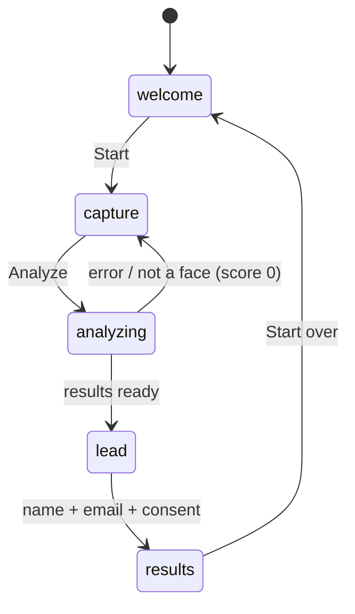

# 02: Architecture

## Components

| Layer | File | Responsibility |
|---|---|---|
| UI | `components/GlowScan.jsx` | Five-step client state machine, camera and file capture, lead gate, results rendering |
| API | `app/api/analyze/route.ts` | Rate limit, validate, call the model, parse and return JSON |
| Prompt | `lib/prompt.ts` | Output schema and tone rules, kept server-side |
| Limits | `lib/rateLimit.ts` | Per-IP fixed window |
| Config | `lib/brand.js`, `.env` | Branding, booking URL, model, limits |

## State machine (client)

## Model contract

The prompt asks for **JSON only**, with fixed keys (`overall_score`, `skin_scores{8}`, `hair_scores{6}`, notes, interests, `fun_fact`). `overall_score: 0` is a sentinel for "not a clear face photo", which sends the user back to capture with the model's message. The route strips accidental markdown fences before `JSON.parse`, and returns a 502 if the response can't be parsed.

## Error handling

| Situation | Response |
|---|---|
| Over rate limit | 429 + `Retry-After` |
| Wrong file type or over 5 MB | 400 |
| Missing API key | 500 "Server not configured" |
| Upstream API error or unparseable output | 502 + friendly message |

## Scaling notes

- The in-memory limiter is per serverless instance. For production use a shared store (for example Upstash Redis).
- Leads are not persisted in this version. Next step: POST the lead plus interest areas to a CRM webhook (GoHighLevel, HubSpot) so nurture can start automatically.
